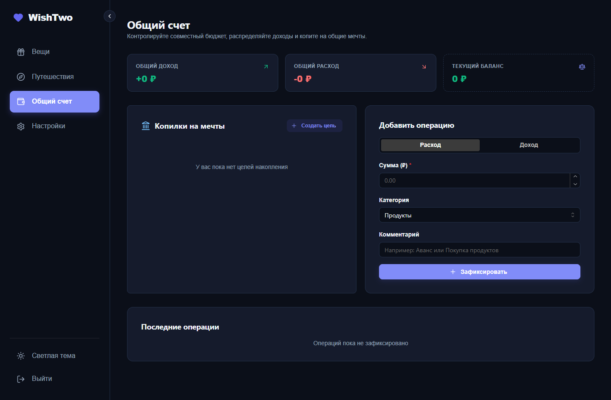

# WishTwo

Веб-приложение для ведения совместных списков желаний, планирования поездок и учета общих финансов.

**Live Demo:** [wish-two-nine.vercel.app](https://wish-two-nine.vercel.app/)

<div align="center">
  <table border="0" cellpadding="0" cellspacing="0">
    <tr>
      <td width="24%" align="center" valign="top">
        
      </td>
      <td width="24%" align="center" valign="top">
        
      </td>
    </tr>
  </table>
</div>


## Технологический стек

* **Frontend:** React 19, TypeScript, Vite, Redux Toolkit, React Router DOM v7, Mantine UI v9 (`core`, `hooks`, `modals`, `notifications`), SCSS, CSS Modules, Lucide Icons, `browser-image-compression`.
* **Backend & Infra:** Supabase (PostgreSQL, Auth, Storage, RLS), Vercel, GitHub Actions.
* **Качество кода:** ESLint, Stylelint (`stylelint-config-standard-scss`), Prettier.

---

## Архитектура и функционал

* **Списки желаний и приватность:** приватные позиции («сюрпризы») с изоляцией данных на уровне PostgreSQL (Supabase Row Level Security), анонимное бронирование подарков и автоматический парсинг метаданных товара по ссылке.
* **Финансы и поездки:** расчет общего баланса, трекинг целевых накоплений с прогресс-барами и планировщик совместных поездок.
* **Оптимизация и UI:** клиентское сжатие и конвертация изображений перед загрузкой, управление модалками и уведомлениями через Mantine, поддержка светлой и темной темы.

---

## Быстрый старт

1. Клонируйте репозиторий и установите зависимости:
   ```bash
   git clone https://github.com/Vinkol/wish-two.git
   cd wish-two
   npm install
   ```

2. Создайте файл `.env` в корне проекта:
   ```env
   VITE_SUPABASE_URL=your_supabase_project_url
   VITE_SUPABASE_ANON_KEY=your_supabase_publishable_key
   ```

3. Запуск и проверка кода:
   ```bash
   npm run dev           # Локальный dev-сервер (Vite)
   npm run build         # Проверка типов (tsc) и production-сборка
   npm run preview       # Предпросмотр production-сборки
   npm run fix-all       # Форматирование (Prettier) + автофикс ESLint и Stylelint
   ```

